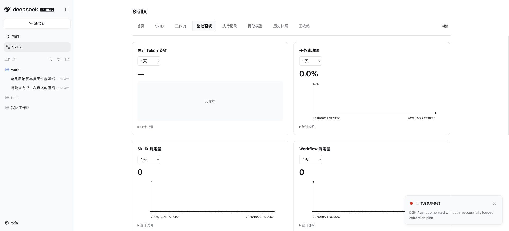

# 隔离依赖、恢复与自主提取实验

日期：2026-10-22。结论：原始脚本与受控恢复验收通过；两次有效模型自主提取均失败，未发布能力。因此本轮 SkillX/workflow 执行、三层工作流嵌套和执行节省率均未验证。

## 实验边界与方法

- 独立 DSH_HOME/profile、127.0.0.1:3081 服务和目录；现有 3080 服务未重启、未改配置。
- Docker/Colima Linux aarch64，专用容器根目录只读、cap-drop ALL、no-new-privileges；只挂载测试工作目录（可写）与独立 DSH 数据目录（只读），不挂载 Docker socket。
- 基础镜像 Node 22 Bookworm，镜像内补齐 Python venv。Node 22.23.4、Python 3.11.2。目标依赖均由 DSH Agent 自己安装至测试目录；无宿主全局安装。
- 固定直接依赖：esbuild 0.25.10；NumPy 2.0.2、pandas 2.2.3、PyArrow 19.0.1；sharp 0.34.3、Ajv 8.17.1。传递依赖没有全部锁定，因此不声称逐字节可复现环境。
- 输入为合成 CSV、SVG、JS 与版本 manifest。Agent 自行编写、运行、修复；验收方只提供输入、隔离环境、业务目标与验收反馈。没有手改提取计划、候选能力或生成脚本。
- 原始任务完成后，通过网页“总结工作流”自主提取。输入与原有 DSH 配置的 SHA-256 在前后检查。

## 原始执行的实际发现

| 场景 | 已核对事实 | 结论边界 |
| --- | --- | --- |
| 复杂 Python 库 | 真实 CSV 类型/ID 校验、过滤、groupby、Parquet 写入和读回 | Linux aarch64 本次固定版本；未测试任意原生库或 Windows |
| 复杂 JS 库与 CLI | sharp 生成并解码 8×6 PNG，逐像素 RGBA 51/102/153/255；Ajv 验证 JSON；esbuild 打包后实际调用 square(7)=49 | import/编译成功不是最终验收条件 |
| CLI 并发首次安装 | 四个进程请求相同空 prefix，最终仅一次 install-start，各调用成功 | 一次并发试验，不外推高负载成功率 |
| 安装器中断 | 杀死真实 npm 与安装器，未写 ready；起初因失效锁等待约 600 秒，Agent 自行修复后重试成功 | 已覆盖失效 owner；未证明多个进程同时回收失效锁不存在竞态 |
| 写入后中断 | npm 已写出 16 个包文件后 SIGTERM；无 ready；同目录恢复并实际验证 CLI | npm 自行回滚，残留文件为 0；未覆盖断电/SIGKILL 后损坏包残留 |
| 环境故障 | 不可达代理+空缓存导致真实 npm 失败；恢复环境后成功。缺失 Node runtime 路径失败，同源代码恢复路径后成功 | 是受控故障，不是盲测任意故障分类 |
| 代码故障 | pandas 引用不存在的列触发 KeyError；依赖仍正常；仅改代码副本后成功 | 受控代码缺陷，以及自然发生的模块解析/锁/ready 顺序缺陷 |
| 并行与汇合 | 两个数据集各有 CSV、图像、打包三个真实重叠分支；汇合开始时间晚于所有必需分支结束 | 固定业务图，不代表通用 DAG 引擎 |
| 失败传播 | 图像分支失败时 aggregate 不执行，不报整批业务成功 | 不等同于持久化节点续跑/恰好一次副作用 |

独立计算：training 120 行、active 90 行，g0/g1/g2 各 18,750，合计 56,250；holdout 37 行、active 27 行，g0=6,500、g1=5,125、g2=3,750，合计 15,375。Agent 业务产物与这些结果一致。

自然失败没有从成本中排除：Node ESM 的 NODE_PATH 解析问题；失效锁；先要求 ready 再写 ready 的循环依赖；一次工具响应格式错误；故障注入因 fallback 意外找到已有依赖。最终报告文件会被生成脚本覆盖，故以 DSH 完整会话事件核算全部失败成本，不能只使用最终报告的命令列表。

## 当前“DAG”页面的问题

`client/index.js` 的 `WorkflowDag` 从程序中正则提取编号注释，并按顺序连接节点；未匹配时退化成“输入 → 能力名 → 输出”。当前检查的八个工作流均没有匹配阶段，部分却真实调用多个子能力。输入/输出也计入节点数。

因此，现有页面只是粗略阶段示意，不是控制流 DAG，也不是运行时调用图。四层嵌套、调用次数和一张图都不能单独证明并行、汇合、条件分支与节点恢复。建议先区分：静态能力依赖关系、实际调用轨迹、程序内部未建模逻辑。不要用新增注释伪装完整 DAG；也不要仅为图形增加无独立用途的工作流包装。

## 成本口径

所有模型统一为 TraeCode 提供的 GPT-5.5 medium。Token 来自 DSH assistant/message 与 assistant/attempt 的 usage，分别汇总 inputTokens、cacheReadTokens、outputTokens、totalTokens；包括失败请求，不是新增上下文长度，也不等同于按相同单价计费。未获取账单价格，不换算金额。

对比分开记录：原始开发与故障修复、补充验收、提取（含失败）、首次能力调用与修复、暖环境复用。原始脚本已可复用，不能拿“一次性开发成本”冒充每次原始执行成本。程序直接执行无 LLM 的性质并非 SkillX 独有。

暖环境原始脚本由一个新 Agent 会话查看调用方式后执行三次完整批处理：5.283379、4.631360、5.503983 秒，全部成功。外层计时包括 docker exec、依赖预检与两个数据集的全部分支及汇合。该 Agent 会话共 71.257 秒、135,829 Token，其中输入 81,910、缓存读取 50,176、输出 3,743。三次调用处于同一个会话，不能将会话总 Token 直接当成每次固定成本。

## 提取过程

1. 独立 profile 的提取模型默认指向未配置凭据的 DeepSeek，生成前 MISSING_CREDENTIAL，0 Token、约 240 ms、未发布。只在隔离服务中改为上述同款模型后重试。
2. 第一次有效模型提取：规划阶段 235.417 秒、857,777 Token、16 步。重复的依赖职责缺失未修复，REPAIR_ATTEMPTS_EXHAUSTED，未发布。门禁正确拒绝，但说明自主修复尚不稳定。未放宽结构门禁、未替 Agent 改计划。
3. 第二次有效模型提取：规划阶段 210.806 秒、969,482 Token、17 步。提交 JSON 格式错误被模型适配层拒绝，续跑后仍未成功保存计划，最终 `DSH Agent completed without a successfully logged extraction plan`。没有进入构建阶段，没有发布。两次有效提取合计 446.223 秒、1,827,259 Token。

第一次草稿计划拆为六个能力，第二次拟拆为两个；结构和粒度亦不稳定。没有把这两份未通过计划当作有效多层工作流。静态门禁有效拒绝了错误，不代表运行验收已发生。

重复要求 `dependsOn` 与 responsibilities.capability 同时表达依赖，增加了不一致的机会。可考虑选定单一权威表达并派生另一个字段，同时保留旧格式适配；这是根据失败证据提出的改进方向，尚未实施。

## 完整成本与结论

| 阶段 | 实测时间 | 累计 Token | 结果 |
| --- | ---: | ---: | --- |
| 原始编写、首次安装与修复（含目标收尾） | 17 分 14.577 秒 | 1,345,102 | 受控初始验收通过 |
| 补充写入后中断、分类和并行分支验收 | 4 分 39.419 秒 | 1,766,711 | 补充验收通过 |
| 原始脚本暖环境三次复用，Agent 会话整体 | 71.257 秒 | 135,829 | 三次均通过 |
| 其中纯程序运行 | 5.283 / 4.631 / 5.504 秒 | 0 | 中位数 5.283 秒 |
| 两次有效模型自主提取，含失败 | 7 分 26.223 秒 | 1,827,259 | 均失败，发布数量 0 |
| SkillX/workflow 首次执行、修复、暖复用 | 未执行 | 不适用 | 提取未成功，无可调用能力 |

编写及补测合计 21 分 53.996 秒、3,111,813 Token。此时间为各 Agent 活动轮次之和，包括命令等待，不包含验收方复核间隔和本次容器/profile 准备时间。原始编写 + 补测 + 暖基线 + 失败提取累计 5,074,901 Token。只有输入/输出/缓存三种量的完整口径，不把缓存 Token 当新增推理量；细项见 [metrics.json](metrics.json)。

本次不能计算 SkillX 相对原始脚本的速度提升、Token 节省率或回本次数。尤其不能将数百万 Token 的一次性编写、故障修复与测试成本作为每次复用的原始基线。即使将来工作流程序执行为 0 Token，原始 Python/JS 程序执行同样为 0 Token；应比较发现接口、参数准备、实际执行、结果验证、修复和维护的完整成本。

最短改进路径：

1. 先使提取提交可恢复：小粒度草稿提交与校验失败定位应能可靠使用；模型输出格式错误应归类为协议错误，不能变成含糊的“完成但无计划”。保留无进展检测，但不以总 Token/总耗时阻断仍在推进的任务。
2. 消除依赖关系的重复权威字段，让职责和依赖不再互相漂移。局部修复应定位到对应候选，不要求重发巨大计划。
3. 把目前页面改称阶段概览；另从已声明依赖与实际调用回执显示真实关系、分支状态和嵌套。程序内没有建模的逻辑明确显示为内部步骤，不伪装成宿主 DAG。
4. 在提取成功后，继续同一隔离输入的调用/故障/暖复用验收。发布/语法通过与实际业务通过分开标记。当前不需要为了这个目标引入 Wasm 或完整通用调度引擎。

## 复核与保留物

- 三次暖复用中共六个数据集的行数、active 数、分组金额、分支退出码、并行重叠、汇合顺序均独立核对通过。
- 五个输入文件和原有 DSH 两个 profile 配置文件共七个 SHA-256 不变。当前原始服务未重启。
- 专用容器 `skillx-deps-bix3t7zl` 已停止。保留本次镜像、测试数据和独立网页服务供复核；未向宿主 Python/Node 全局安装业务依赖。
- 本机证据根：`~/.cache/skillx-labs/bix3t7zl`。`work/artifacts` 保存业务和故障报告，`evidence/final-metrics.json` 保存汇总和独立校验，`dsh/native-workflows/jobs` 保存失败草稿/诊断，`dsh/sessions` 保存原始模型用量和工具事件。
- 本报告不复制私有会话正文。仓库只新增实验结论、聚合指标及页面截图；本轮未修改执行器代码，也未手改 Agent 生成内容。

