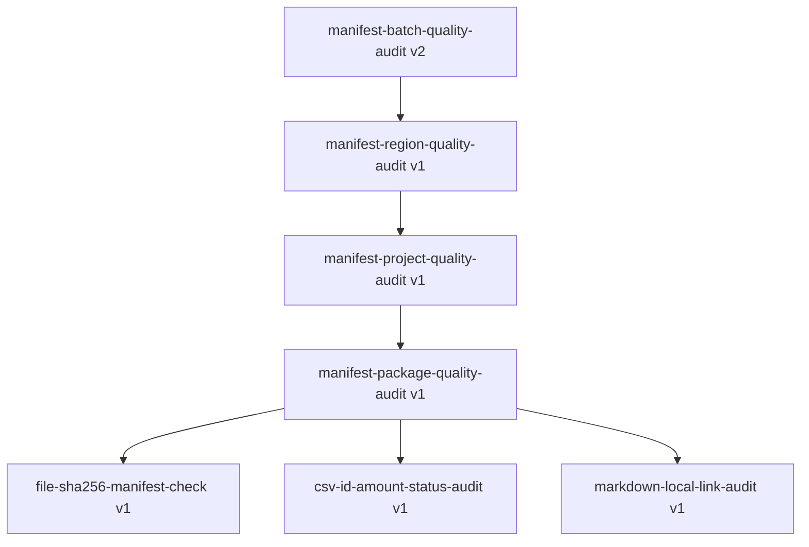
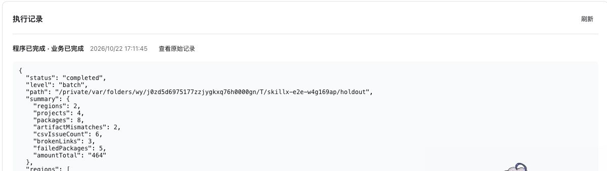

# 宿主稳定性与自主提取验收（2026-10-22）

本次在 macOS arm64、Node v24.14.1、Python 3.9.6、已安装 DSH 原生 PTC/subprocess 运行器上完成。未引入 Wasm。只在 `dsh-skillx-workflow` 修改宿主、契约说明与回归测试；没有手写、修改或替换 Agent 的提取计划、候选程序和发布产物。

## 已落实的改动

- 原生进程的工具传输成功与命令执行成功分开记录。非零退出、超时、取消、信号、stdout 截断都有稳定错误码，不进入成功步骤复用；旧回执复用时重新检查。原有 `processes.run` 返回结构保持兼容，新增 `checkedRun` 用于严格检查及显式接受特定退出码。
- 缺少 CLI/解释器/运行器、Windows Shell 启动器需要配置等错误，经真实 DSH ToolRuntime 和 PTC 传递后仍保留身份，不被折叠成通用程序异常。
- Node 资源脚本先检查无损 JSON，再序列化；拒绝 undefined、NaN、稀疏数组、循环/自定义对象等。stderr 截断不再误伤有效 stdout。
- 可选 `compatibility.probes` 在根能力及其锁定依赖的业务开始前执行、去重。环境缺失直接阻断，不唤起模型修复，也不自动安装软件。旧能力不声明 probes 时保持原行为。
- PTC 的 JavaScript 入口支持 `require` 与动态 `import`，`require` 相对执行 cwd 解析，仍使用原生沙箱。程序可声明自己的 require。
- 提取总耗时/Token 改为估计，不设任务截止时间；连续 `max-tokens` 可继续生成。超过单次响应容量时，可用 `draftOnly` 和现有草稿补丁分多次组装，最终提交仍执行全部校验；未完成草稿不能发布。去除计划、候选、程序、Schema、资源、证据、草稿和恢复文档的固定字节门槛。保留分页、完整性校验、权限、用户取消和重复无效结构保护。旧预算配置仍可读取。
- 默认执行不再因累计 100 次宿主/能力调用被截断；实际执行超时、取消、依赖深度及权限规则保留。显式 `maxCalls` 仍可用于调用方自己要求的执行约束。

## 回归与真实运行器

仓库完整回归：**80/80 通过**。

```sh
npm test
```

其中新增的进程/预检测试使用真实 Node/Python 子进程，普通测试只替换 PTC 宿主接缝。额外将同一组测试接入实际安装的 DSH subprocess-local 与 ptc-runtime-node：**14/14 通过**，包括四层工作流嵌套与超过 100 次能力执行。

```sh
DSH_RUNTIME_MODULES=/opt/homebrew/lib/node_modules/@deepseek-ai/dsh/node_modules \
  node --test tests/process-regression.test.js
```

`DSH_RUNTIME_MODULES` 应指向本机 DSH 的 node_modules；Python 非默认路径时可设置 `SKILLX_TEST_PYTHON`。这些结果不代表 Windows/Linux 实机已验收。

## 网页端实验方法

使用 [隔离素材生成器](../../../scripts/create-readonly-audit-fixture.py)：

```sh
python3 scripts/create-readonly-audit-fixture.py
```

它创建新的临时目录并打印路径。`training` 有 3 个区域、9 个项目、27 个数据包，共 121 个文件；`holdout` 有 2 个区域、4 个项目、8 个数据包，共 39 个文件。路径含中文与空格，内容完全合成。预期结果与原始哈希在两组目录之外，不提供给源任务或提取 Agent。

网页任务要求如下（`<training>` 替换为生成路径）：

> 只读审计 `<training>` 内的 batch.json → region.json → project.json → manifest.json，遍历全部清单，不抽样。每包验证 artifact 的 SHA-256、CSV 的 id 非空唯一/amount 有限非负/status 合法，以及 Markdown 本地链接存在性。CSV 使用 Python csv/decimal 标准库，文件与路径可使用 Node 标准库。逐包保留问题明细，逐项目、区域与批次汇总覆盖数量、摘要不匹配数、CSV 问题数、坏链接数、失败包数和合法金额。质量问题是审计发现，不能当成任务未执行。只读取授权目录；不联网、不安装、不修改输入、不调用其他 Agent；本轮只完成业务，不创建能力。后续应能复用批次 → 区域 → 项目 → 数据包的工作流层级及三类原子检查。

源任务完成后，通过网页“总结工作流”触发原生 Agent 自主提取；未向其传入参考实现或预期答案，也未介入草稿修复。这里明确要求层级以验证嵌套机制，不能据此宣称模型会在无层级要求时自行发现相同分解。

## 提取与失败修复事实

1. 首次规划失败：旧 16,000 字节门槛拒绝 17,218 字节计划；12 步、485,240 Token。最初仅改进宿主诊断后重新从原会话发起提取，没有缩写或编辑 Agent 计划。
2. 第二次提取成功：25 步、1,261,608 Token，7 分 11.88 秒。Agent 自己处理规划校验和一次工具响应格式失败，最终发布 3 个 SkillX、4 个工作流。
3. 按用户后续要求移除上述固定字节/时间门槛，以回归测试验证放宽行为。第二次真实提取在这些放宽生效前已完成，不能把它作为“无限时运行”的实测证据。
4. 第一次网页调用在 Python 预检成功后，报 `ReferenceError: require is not defined`。静态语法合法并没有掩盖实际执行失败。原生修复 Agent 重新完成了只读业务，随后诊断/优化链自行将根工作流从 v1 更新为 v2，将模块加载改为动态 import；其余六个能力仍是 v1。这个恢复结果不计作嵌套程序直接执行成功。
5. 宿主补齐 Node 模块接口，并取消默认 100 次调用门槛后，网页再次执行完整数据及 holdout。两次都是正常程序路径，`relatedSessions: []`、`usage: []`、无 `recovered` 标记，不依赖修复 Agent 代跑。

这些 Token 是 DSH 返回的实验任务累计口径，包含各次请求的输入、缓存读取与输出；不是新增上下文长度，不包含其他用户会话。数值仅描述本次实验成本，不推导普遍成功率或节省比例。

## 实际依赖图



四个工作流层级，三个工作流间嵌套关系。CSV SkillX 通过受管 `@python -c` 执行外部解释器及 csv/decimal 标准库；其他检查使用 Node 标准库。独立资源脚本及其 JSON 协议另由原生运行器回归覆盖。

## 正常程序路径验收结果

| 项目 | training | holdout |
|---|---:|---:|
| 区域/项目/数据包 | 3 / 9 / 27 | 2 / 4 / 8 |
| 摘要不匹配 | 6 | 2 |
| CSV 问题 | 21 | 6 |
| 坏链接 | 9 | 3 |
| 存在质量问题的数据包 | 16 | 5 |
| 合法金额合计 | 1558.5 | 464 |
| 能力实现执行次数 | 121 | 39 |
| 原生进程调用（含一次预检） | 28 | 9 |
| 耗时 | 11.839 秒 | 3.628 秒 |
| 执行阶段 LLM 用量 | 0 | 0 |
| 完整结果字节数 | 48,348 | 15,643 |
| 输入文件 | 121 个哈希不变 | 39 个哈希不变 |

所有汇总字段与生成器预期相等（金额按 Decimal 比较）；逐层遍历完整保存结果，各层均为 completed，所有进程步骤 succeeded。121 次能力调用由根 1、区域 3、项目 9、数据包 27、三个 SkillX 各 27 次构成，证明实际发生嵌套与扇出。

本机审计索引（不复制会话内容）：

- training 执行回执：`302dbb87-e7e4-4ae5-bebf-ab79719fa161`
- holdout 执行回执：`0c478922-bffb-477e-88c6-a3ef065d3839`
- 回执及完整结果位于 DSH 数据根的 `executions/<runId>/receipt.json`、`events.jsonl`、`output.json`。

training 结果超过普通交付的 16 KiB 预览阈值；验收读取的是保留的完整结果，未把网页机械预览中的 null/短路径当作业务原值。网页目前只画当前工作流的阶段，完整嵌套由锁定依赖和逐层执行回执验证。



## 结论与边界

本轮确认了“自主提取多个 SkillX + 四层工作流 + 外部 Python 标准库 + 中文路径 + 全量覆盖 + 无模型代跑”的正常路径。首次调用确实暴露了“可保存但不可执行”的问题，恢复及后续直接执行均有真实证据；没有把静态通过称作业务验收。

仍不能保证任意生成程序可用。预检只能检查声明的环境条件；库导入、业务权限与真实数据行为需要各自的实际验收。未验证 Windows/Linux 实机、复杂第三方原生库、离线安装、CLI 并发安装及安装中断恢复；本批没有增加自动安装器或 Wasm。运行器仍受机器资源和模型单次上下文/输出容量约束，取消提取成本门槛不代表物理容量无限。
